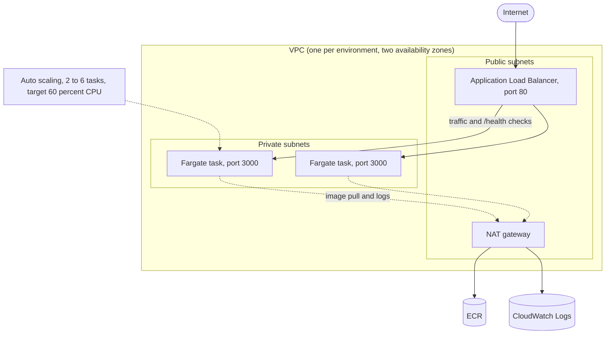
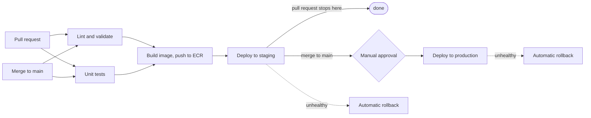

# infra-as-code-pipeline

Zero-touch deployments of a containerised web service to AWS. The infrastructure is written as Terraform modules, and a GitHub Actions pipeline lints, tests, builds and deploys it to ECS Fargate. Staging deploys automatically, production waits for a manual approval, and an unhealthy release is rolled back automatically.

Capstone Project 3, DevOps Institute Mumbai.

> Status: every part of this repository was applied and tested on AWS during development, then destroyed to avoid cost, so there is no live URL. Evidence from the runs is in [docs/evidence.md](docs/evidence.md). The Setup section rebuilds everything.

## What was delivered

| Requirement | Where |
|---|---|
| Terraform modules: networking, compute (ECS), security, monitoring | `infra/modules/` |
| Remote state in S3 with DynamoDB locking | `bootstrap/`, `infra/backend.tf` |
| Separate workspaces for dev, staging and prod | `infra/envs/*.tfvars` |
| Pipeline: lint, test, build, push to ECR, deploy staging, approval, deploy prod | `.github/workflows/pipeline.yml` |
| Rollback when a release is unhealthy | `scripts/deploy.sh`, ECS deployment circuit breaker |
| Health checks, auto-scaling (2 to 6 tasks), CloudWatch logging | `infra/modules/compute`, `infra/modules/monitoring` |
| No secrets in code | GitHub OIDC, no stored AWS keys (`github-oidc/`) |
| Architecture, pipeline flow, setup, runbook, cost estimate | this README |

## Architecture



Each environment gets its own VPC, load balancer, ECS cluster, ECR repository, IAM roles and log group, all created from the same code with a different `tfvars` file.

| | dev | staging | prod |
|---|---|---|---|
| VPC range | 10.10.0.0/16 | 10.20.0.0/16 | 10.30.0.0/16 |
| NAT gateway | none (saves cost) | one | one |
| Containers run in | public subnets, with a public IP | private subnets | private subnets |
| Deployed by | `scripts/deploy.sh` by hand, used for testing | pipeline on every pull request and on main | pipeline on main, after approval |

Traffic path and security groups:

- The load balancer security group accepts port 80 from the internet and may only send to the container security group on port 3000.
- The container security group accepts port 3000 only from the load balancer security group, never from an IP range. In dev, where containers have public IPs, this is what keeps them unreachable directly.
- ECS uses two IAM roles. The task execution role (the AWS managed ECS policy) pulls images and writes logs. The task role is the application's identity and has no permissions at all.
- Container logs go to a CloudWatch log group with 7 day retention.
- The service keeps 100 percent of healthy tasks during a deployment (`minimum healthy 100`, `maximum 200`), so old tasks keep serving until new ones pass health checks.

## Pipeline flow



| Job | What it does |
|---|---|
| Lint and validate | `terraform fmt -check`, `terraform validate` for every root (`bootstrap`, `infra`, `github-oidc`), and TFLint. Needs no AWS access. |
| Unit tests | `npm ci` and `npm test` |
| Build and push image | Logs in to AWS with OIDC (staging role), builds the image, pushes it to the staging ECR repository tagged with the first 7 characters of the commit SHA. Skips the push if that tag already exists, because tags are immutable. |
| Deploy to staging | Runs `scripts/deploy.sh staging` |
| Deploy to production | Only on a push to main. Needs approval from the `production` GitHub environment, which requires a reviewer and allows only the `main` branch. Deploys the same image that passed staging. |

### How deployment and rollback work

`scripts/deploy.sh` is the only thing that changes what is running:

1. It records the task definition revision that is running now.
2. It registers a new revision with the new image and `APP_VERSION`.
3. It points the ECS service at the new revision.
4. It waits for ECS to report the service stable, for at most 5 minutes.
5. It calls the load balancer repeatedly and requires 5 consecutive good answers from `/health` and from `/` showing the new version.
6. If any step fails, it points the service back at the recorded revision, waits for it to stabilise and exits with an error, so the job turns red.

A second layer sits underneath: the ECS service has its deployment circuit breaker enabled with rollback.

A rollback re-points the service at an existing revision and does not rebuild anything. It still has to start new Fargate tasks, so it is not instant, and no under-60-seconds figure is claimed here. The measured times from the test runs are in [docs/evidence.md](docs/evidence.md).

### Who may deploy

There are no AWS keys in GitHub. Each job requests a short-lived token through OIDC for one GitHub environment:

- `iac-pipeline-github-staging` trusts only jobs from this repository running in the `staging` environment. It can deploy to the staging service and push to the staging registry.
- `iac-pipeline-github-prod` trusts only the `production` environment. It can deploy to the production service and cannot push images.
- Neither role can create or change infrastructure. Infrastructure changes go through Git and Terraform.

## Repository layout

```text
.
├── app/                  Node.js service (/ and /health), Dockerfile, tests
├── bootstrap/            creates the S3 state bucket and DynamoDB lock table
├── infra/                main Terraform root
│   ├── modules/          networking, security, compute, monitoring
│   └── envs/             dev.tfvars, staging.tfvars, prod.tfvars
├── github-oidc/          GitHub OIDC provider and the two deploy roles
├── scripts/deploy.sh     deploy, verify, roll back
└── .github/workflows/    pipeline.yml
```

## Setup

Prerequisites: an AWS account and a CLI profile that can create the resources, Terraform 1.5 or newer, Docker, the GitHub CLI, jq and TFLint.

1. Create the remote state storage. The bucket name contains an AWS account ID, so change `iac-pipeline-tfstate-<account id>` in `bootstrap/main.tf`, `infra/backend.tf` and `github-oidc/backend.tf` to match your account. The bootstrap state is kept local on purpose, because it creates the bucket that holds every other state. Keep that file outside the repository.

```bash
cd bootstrap
terraform init -backend-config="path=$HOME/.tfstate/bootstrap.tfstate"
terraform apply
```

2. Create the OIDC provider and deploy roles. Repositories that use the immutable OIDC subject format (check with `gh api repos/<owner>/<repo>/actions/oidc/customization/sub`) must set `github_subject_prefix` to the `sub_claim_prefix` value shown there. This repository needed it.

```bash
cd github-oidc
terraform init
terraform apply
terraform output role_arns
```

3. In the GitHub repository settings:
   - Create environments named exactly `staging` and `production`.
   - On `production`, require a reviewer and limit deployment branches to `main`.
   - Add an environment variable `AWS_ROLE_ARN` to each, holding that environment's role ARN. Do not swap them.
   - Add repository variables `AWS_REGION` (`ap-south-1`) and `DEPLOY_ENABLED` (`true` turns the deploy jobs on, anything else skips them).
   - Protect `main`: require a pull request and the checks `Lint and validate` and `Unit tests`.

4. Build each environment. The ECS service needs an image in its registry at startup, so create the registry and push a first image before the full apply. Check `terraform workspace show` before every plan and apply.

```bash
cd infra
terraform init
terraform workspace new staging
terraform apply -target=module.compute.aws_ecr_repository.app -var-file=envs/staging.tfvars
# push a first image tagged v1 to the iac-pipeline-staging-app repository, then:
terraform apply -var-file=envs/staging.tfvars
```

Repeat with `prod` (its own registry and its own first image). Use `dev` the same way for experiments.

5. Deploy through the pipeline. Open a pull request: lint, tests, build and the staging deploy run. Merge it: the same checks run on main, staging deploys, then the production job waits for approval on the run page (Review deployments).

6. Tear everything down when finished, then set `DEPLOY_ENABLED` to `false`:

```bash
terraform workspace select staging && terraform destroy -var-file=envs/staging.tfvars
terraform workspace select prod && terraform destroy -var-file=envs/prod.tfvars
```

## Runbook

Set `ENV` to `staging` or `prod` in the commands below.

### 1. A deploy job failed and rolled back

Meaning: the new version never became healthy, and the service was returned to the previous revision. Users were not affected, because old tasks kept serving.

```bash
ENV=staging
aws ecs describe-services --cluster iac-pipeline-$ENV-cluster --services iac-pipeline-$ENV-service --query "services[0].events[:8].[createdAt,message]" --output text
for t in $(aws ecs list-tasks --cluster iac-pipeline-$ENV-cluster --desired-status STOPPED --query "taskArns[:4]" --output text); do
  aws ecs describe-tasks --cluster iac-pipeline-$ENV-cluster --tasks $t --query "tasks[0].[stoppedAt,stoppedReason]" --output text
done
aws logs tail /ecs/iac-pipeline-$ENV --since 30m
```

| Stopped reason | Likely cause |
|---|---|
| Failed ELB health checks | The app is not answering on port 3000, or crashes. Check the app port and the logs. |
| CannotPullContainerError | The image tag is missing from the staging registry. Re-run the pipeline so the build job pushes it. |
| Essential container exited | The app crashed at startup. The logs show why. |

### 2. The site returns 503 or 504

```bash
TG=$(aws elbv2 describe-target-groups --names iac-pipeline-$ENV-tg --query "TargetGroups[0].TargetGroupArn" --output text)
aws elbv2 describe-target-health --target-group-arn $TG --query "TargetHealthDescriptions[].[Target.Id,TargetHealth.State,TargetHealth.Reason]" --output text
aws ecs describe-services --cluster iac-pipeline-$ENV-cluster --services iac-pipeline-$ENV-service --query "services[0].[desiredCount,runningCount]" --output text
```

No targets or none healthy: see scenario 1. Running count below desired: read the service events.

### 3. Roll back by hand

```bash
aws ecs list-task-definitions --family-prefix iac-pipeline-$ENV-app --sort DESC --max-items 5
aws ecs update-service --cluster iac-pipeline-$ENV-cluster --service iac-pipeline-$ENV-service --task-definition iac-pipeline-$ENV-app:<previous revision>
aws ecs wait services-stable --cluster iac-pipeline-$ENV-cluster --services iac-pipeline-$ENV-service
```

Terraform ignores the task definition and desired count of the service, so it will not undo this.

### 4. Terraform says the state is locked

Confirm that no apply or pipeline run is in progress, then release the lock with the ID shown in the error:

```bash
terraform force-unlock <LOCK_ID>
```

### 5. The state file is damaged or lost

The bucket is versioned. List the versions, then copy an earlier one back over the current key:

```bash
aws s3api list-object-versions --bucket iac-pipeline-tfstate-<account id> --prefix env:/staging/
```

### 6. The pipeline cannot log in to AWS

The error is `Not authorized to perform sts:AssumeRoleWithWebIdentity`. The token's subject does not match the role's trust policy. Check the environment name (`staging` or `production`), the `AWS_ROLE_ARN` variable of that environment, and the subject GitHub actually sent (CloudTrail, event `AssumeRoleWithWebIdentity`). Repositories with the immutable subject format send `repo:<owner>@<id>/<repo>@<id>:environment:<name>`, which is what `github_subject_prefix` must contain.

### 7. A deploy fails with AccessDenied on one action

A permission is missing from the deploy role in `github-oidc/main.tf`. IAM names load balancer actions `elasticloadbalancing:...`, not `elbv2:...`. Add the action, run `terraform apply` in `github-oidc/`, and re-run the failed job.

### 8. Push to ECR fails because the tag exists

Tags are immutable by design. The pipeline skips the push when the tag is already there. Make a new commit for a new image.

### 9. Terraform fails with VpcLimitExceeded

An account allows 5 VPCs per region by default, and each environment needs one. Delete VPCs you no longer use or request a quota increase.

### 10. A production approval is stuck

Open the run page and use Review deployments. Approve only if that run belongs to the current main commit. A run left waiting for a long time may reference an image that no longer exists, so cancel it and re-run it.

### 11. Cost emergency

Destroy the environments (Setup, step 6). Then check for anything left running:

```bash
aws ec2 describe-nat-gateways --filter Name=state,Values=available,pending --query "NatGateways[].NatGatewayId"
aws elbv2 describe-load-balancers --query "LoadBalancers[].LoadBalancerName"
aws ecs list-clusters
```

## Estimated monthly cost

Basis: 730 hours a month, always on, 2 tasks of 0.25 vCPU and 0.5 GB per environment, almost no traffic. Prices are US East list prices, because I could not confirm the Mumbai (ap-south-1) rates: NAT gateway $0.045 per hour, public IPv4 address $0.005 per hour each, Fargate $0.04048 per vCPU-hour and $0.004445 per GB-hour. The load balancer rate of $0.0225 per hour is from memory and should be checked. Asia Pacific regions are usually more expensive than US East (published NAT gateway rates for Tokyo and Sydney are about 31 to 38 percent higher), so treat these as a lower bound and enter ap-south-1 prices into the AWS Pricing Calculator for a final figure.

| Item | staging or prod | dev |
|---|---|---|
| NAT gateway ($0.045 x 730 h) | $32.85 | none |
| Public IPv4 for the NAT gateway | $3.65 | none |
| Application Load Balancer, hourly | $16.43 | $16.43 |
| Public IPv4 for the load balancer (2 addresses) | $7.30 | $7.30 |
| Public IPv4 for the containers (2 tasks) | none | $7.30 |
| Fargate vCPU (2 x 0.25 x 730 h) | $14.78 | $14.78 |
| Fargate memory (2 x 0.5 GB x 730 h) | $3.25 | $3.25 |
| Logs, ECR storage, load balancer usage (assumed) | about $1 | about $1 |
| **Per environment** | **about $79** | **about $50** |

All three environments always on: about $209 a month. Shared items (S3 state bucket, DynamoDB lock table, OIDC provider, IAM roles) cost cents.

Other costs: autoscaling at the maximum of 6 tasks roughly triples the Fargate lines. NAT data processing ($0.045 per GB) and data transfer are excluded.

How the project was actually run: environments existed only while testing and were destroyed afterwards. At the rates above, an environment with a NAT gateway costs roughly $0.11 per hour, so a test session of a few hours costs well under the monthly figure.

## Design decisions and known limitations

- Terraform owns infrastructure, and the pipeline owns which image runs. The ECS service ignores changes to `task_definition` and `desired_count`, so `terraform apply` does not undo a deployment.
- One image is built and reused. Production runs the image that passed staging, pulled from the staging registry. A stricter setup would push to a production registry as well.
- One NAT gateway per environment, not one per availability zone. If its zone fails, outbound access from the other zone's containers is lost. Production would use one per zone, at extra cost.
- Dev has no NAT gateway, so its containers run in public subnets with public IPs, protected only by the security group. Staging and prod use private subnets.
- The load balancer listens on HTTP only. A real deployment needs a domain, an ACM certificate and an HTTPS listener.
- The Terraform user in this project had administrator access, for speed. A real team would scope it down.
- Workspaces share one backend and one set of credentials, so they isolate state but not permissions. Separate accounts per environment would isolate more.
- The monitoring module holds the log group only. There are no CloudWatch alarms yet.
- ECR scan-on-push is enabled, but I did not verify any scan results. No Trivy or tfsec step was added.
- State locking uses DynamoDB as the brief requires. Newer Terraform versions can lock directly in S3 (`use_lockfile`) and warn that `dynamodb_table` is deprecated.
- GitHub Actions are pinned to major version tags, not commit SHAs. The runner image is pinned to `ubuntu-24.04`.
- The unit tests only cover `/health`. A bug in how the server starts passes CI and fails at deployment, which is exactly the case the rollback test uses.

## Not implemented (stretch goals)

Terraform plan as a pull request comment, blue-green deployment with CodeDeploy, security scanning with Trivy and tfsec, Slack notifications, cost estimation with infracost.
